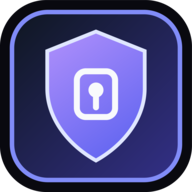

# Relays: installing them, and linking them to each other

For v2.98.27 · build chat-v120

This is the operational guide for running more than one relay and having them
carry for each other. It covers what to put on which kind of server, how to
turn on a TURN server so calls take the short path, how to link two relays, and
— stated plainly rather than buried — what each machine can and cannot see once
you do.

---

## 1. Decide what goes on each server

There are two things you can install, and they are not the same decision.

| | What it is | Use it when |
|---|---|---|
| **Full stack** (`config/docker-compose.yaml`) | The web app, the relay, coturn, the monitor, certificate renewal | This server is where people load the app from |
| **Standalone relay** (`standalone-relay/`) | The relay and coturn, nothing that serves the app | This server only carries traffic |

Two full stacks is a third arrangement, and the one this project runs: each
server serves the whole application to its own users, on its own domain, with
its own relay identity, its own TURN server and its own offline mailboxes, and
the two relays link to each other. Neither is a subordinate of the other. A
person who loads the app from either one can hold a conversation with a person
who loaded it from the other; the message is sealed to the recipient's relay
before it is handed over, so the relay that carries it cannot read it. Nothing
extra is needed for this beyond section 5 — set `ROLE='app'` for both servers in
`scripts/deploy.sh`'s settings file and link them.

Nothing in `config/nginx.conf` names a host. The domain and the origins in the
Content-Security-Policy are filled in when the container starts, from `DOMAIN`
and `APP_PORT` in that server's `.env`. Do not edit the file to change them:
`deploy.sh` copies `config/` from the working tree on every deployment, so an
edit there survives until the next deploy and no longer.

> **Read this before putting the full stack somewhere you would not put your
> keys.** The relay cannot read a message — everything is encrypted in the
> client before it is handed over. But the server that serves the *app* serves
> the JavaScript that does the encrypting. An operator who is compelled can
> serve a modified copy that sends the key somewhere, and no user can tell.
> That is a different class of risk from running a relay, and it is the reason
> Signal ships installable apps rather than a web page.
>
> If a server sits somewhere you would rather not trust with the code, put the
> **standalone relay** there and have people use the native build (Android,
> iOS, desktop) pointed at it. The code then lives in a signed binary and the
> server only carries traffic.

---

## 2. A standalone relay, from nothing

### First, one privileged step

Three things a deployment needs cannot be arranged over an ordinary SSH session
with a key, and each of them needs root once:

- the account has to be in the `docker` group, or every compose command is
  `permission denied`;
- the TLS certificate usually sits under `/root` or `/etc/letsencrypt`, where the
  deploying account cannot read it and coturn has to;
- the install directory has to exist and belong to that account.

Run this once, on the server, and nothing after it needs privilege:

```bash
sudo bash scripts/prepare-relay-host.sh pooriya /root/cert/relay.example.com
```

It finds the certificate whatever the issuer named the files, copies it where the
containers can read it, and says plainly that a renewal does not copy itself —
point the renewal's deploy hook at the copy, or run this again after each
renewal.

Everything from here is key-based, from your own machine.

### Then the relay itself

On the server:

```bash
git clone https://github.com/Poorija/P00RIJA-Cryptography.git
cd P00RIJA-Cryptography/standalone-relay
bash setup.sh
```

It asks for a domain, a public IP and a monitor password, then writes `.env`,
generates a certificate if there is none, and starts both containers. It
generates `TURN_USER` and `TURN_PASSWORD` for you and writes a `CHAT_TURN_URL`
clients can actually reach — an address is no use to anybody if it says
`localhost`.

Check it:

```bash
curl -s https://relay.example.com:9000/chat-health | head -c 400
curl -s https://relay.example.com:9000/relay-identity
```

`/relay-identity` is what the rest of this document needs. Write the `id` down.

---

## 3. The full stack

```bash
cp .env.example .env
nano .env          # DOMAIN, MONITOR_PASSWORD, TURN_USER, TURN_PASSWORD
npm run setup:server:linux
```

`TURN_USER` **and** `TURN_PASSWORD` are both required and the containers refuse
to start without them. That is deliberate: coturn's credential is a pair, and a
relay that started with only half of one used to hand every client a username
belonging to somebody else's deployment.

---

## 4. TURN, and why it is worth a server of its own

Call media never goes through the relay. It is either peer to peer, or it goes
through a TURN server. So the relay's location does nothing for call quality —
the TURN server's location is the whole of it.

```
Without a nearby TURN:   you → TURN abroad → them
                         the international leg runs on your home connection

With a nearby TURN:      you → TURN near you → TURN near them → them
                         the international leg runs datacentre to datacentre
```

The second path is **ordinary ICE**, not a trick. Each side offers its own
relayed candidate; when the chosen pair is relay-to-relay the path is two hops
by itself. The only condition is that each client gets the TURN nearest to
*itself*, and that is already how it works: `/turn-config` is read from the
relay that client is connected to.

Two things follow for an operator:

- **Run coturn on the relay nearest your users.** It is already in both compose
  files. Port 3478 UDP and TCP, 5349 TLS, and the media range 49152–50152 UDP
  have to be open.
- **UDP matters.** TURN carries the media itself, and a call relayed over TCP
  sounds worse than the same call over UDP: a reliable ordered stream under a
  codec that would rather drop a late packet than wait for it.

Bandwidth, honestly: every relayed call passes through the server twice, in and
out. A video call at the 8 Mbit ceiling is 8 in and 8 out, so ten concurrent
calls is about 160 Mbit/s.

### Two TURN servers

A client with two TURN servers configured measures both and remembers which one
worked **for each contact** — a device with a near server and a far one has two
different right answers. It puts the remembered one first, and if a call stays
poor for several samples it moves the call to the other one. That costs a short
gap in the audio, so it happens at most once per call.

Nothing has to be configured for this beyond having two servers in
`CHAT_TURN_URL`. The call quality panel shows which way each call went.

---

## 5. Linking two relays

This is what lets somebody on relay A write to somebody on relay B. The relay
that carries the message **cannot open it**: the client seals the real envelope
to the recipient's relay before handing it over, so the carrier sees a relay id,
a byte count and a time, and nothing else.

It is **off until you turn it on**. A relay that carried for anyone who asked
would be an open relay — somebody else's traffic at your expense — and this
arrangement is between operators who have already agreed with each other.

### Step 1 — get each relay's identity

On each server:

```bash
curl -s https://relay-a.example.com/relay-identity
curl -s https://relay-b.example.com/relay-identity
```

Each answers an `id` of 64 hex characters. That id is the SHA-256 of the
`publicKey` in the same answer, so it is a name the relay cannot lie about —
you can verify it:

```bash
curl -s https://relay-a.example.com/relay-identity \
  | sed -n 's/.*"publicKey":"\([^"]*\)".*/\1/p' | base64 -d | sha256sum
```

**The short way.** When both servers are up and named in `scripts/deploy.sh`'s
settings file, one command does all four steps — reads both identities, names
each to the other, restarts the relays and waits for the link to actually come
up:

```bash
bash scripts/link-relays.sh <first> <second>
```

`--status` says what is linked to what. When one side's certificate does not
verify from here it links them asymmetrically on its own: the side that can
verify dials, the other only answers, and verification is not turned off
anywhere.

The steps below are the same thing by hand, for servers that are not in that
file.

### Step 2 — name each relay to the other

In relay **A**'s `.env`:

```
CHAT_TRANSIT_PEERS=<relay B's id>@https://relay-b.example.com
```

In relay **B**'s `.env`:

```
CHAT_TRANSIT_PEERS=<relay A's id>@https://relay-a.example.com
```

Then restart both: `docker compose up -d`.

`CHAT_TRANSIT_PEERS` has to be named in the `environment:` block of the compose
file as well as set in `.env`, or it never reaches the container and transit
stays off however the file is written. Both compose files in this repository
list it. If you are linking an install that predates this, check for the line
before wondering why `up` stays at 0.

An entry is `<relay id>@<origin>`. The id is what matters; the address is only
how to get there. A **bare id with no address** means "accept a link from this
relay but never dial it" — that is the setting for a relay behind a firewall
that has to call out. At least one of the two must have the other's address.

### Step 3 — check the link is up

```bash
curl -s https://relay-a.example.com/chat-health \
  | sed -n 's/.*"transit":{\([^}]*\)}.*/\1/p'
```

```
{"enabled":true,"allowed":1,"up":1,"hybrid":1}
```

- `enabled` — this relay will carry for somebody
- `allowed` — how many relays are named
- `up` — how many are reachable right now
- `hybrid` — how many of those negotiated the post-quantum half

`hybrid` short of `up` is not an error: a relay built before ML-KEM links
classically, and the two modes derive different keys so one can never be
mistaken for the other.

### Certificates between relays

The link is authenticated by relay identity whatever the transport says, so the
certificate is defence in depth rather than the control.

When one side's certificate is one you signed yourself, `CHAT_TRANSIT_INSECURE_TLS=1`
is the LAST resort rather than the first. The better arrangement needs no such
setting on either relay: let only the side that CAN verify the other do the
dialling, and give the other side a **bare id with no address**. A link that is
up carries both directions — the two directions have separate keys — so one
successful dial is all it takes, and verification is never turned off anywhere.

```
# on the relay whose certificate is real — answer, never dial
CHAT_TRANSIT_PEERS=<the other relay's id>

# on the relay whose certificate is still self-signed — dial out
CHAT_TRANSIT_PEERS=<the other relay's id>@https://the-other.example.com
```

It changes nothing about how clients reach the relay.

### Calls across the link

A call between two people on different relays needs nothing configured beyond
the link itself, but it is worth knowing what it does, because it is the one
thing that does NOT work the way a same-relay call works.

PeerJS cannot place it. A PeerJS id only means something on the server that
issued it, so the two are registered on two different instances and the id names
nobody. What travels instead is the offer, the answer and the ICE candidates, as
relay payloads — sealed to the recipient's relay like any message, so the
carrying relay cannot read them — and the peer connection is built by the
application rather than by the library. See `js/chat/39-relay-call.js`.

The media does not change. Once the two descriptions are exchanged this is an
ordinary peer connection: direct between the two people where their networks
allow it, and through TURN where they do not. **Each side uses its own relay's
TURN server.** A relayed candidate is only an address, so there is nothing to
share between the two deployments and no server-to-server media path to set up;
two independent TURN servers give better odds of connecting than one.

What each relay sees is what a signalling server has always seen: that these two
are negotiating, and the SDP, which carries candidate addresses and a DTLS
fingerprint. It carries no key material — DTLS-SRTP derives the media keys from
the handshake between the two browsers. A call on one relay exposes exactly this
much to that relay. The carrying relay is not one of the two that sees it.

One consequence to expect: somebody on the other relay is never shown online,
because a relay hands out its own clients and nobody else's. That is ignorance,
not knowledge, and the application treats it that way — it places the call
anyway and lets the far relay's answer say what the truth was, delivering the
offer if they are there and queueing it with a push if they are not.

### What the clients need

A client can only route to a contact whose **home relay** it knows, and it will
only act on that when it came from a contact card — a QR or a pasted code — and
not from anything a relay told it. So people on different relays have to
exchange cards once. After the first message each way, the return route travels
inside the sealed message and the rest is automatic.

### Finding a contact's relay, and TURN across the link (from 2.98.27)

A card is still the best way to learn where somebody lives, but it is no
longer the only one. When a relay queues a message for somebody who has never
proven a key there, its `queued` answer says `known: false`. The client then
asks every relay this one is linked with — listed at `GET /transit-peers`,
with the key to seal to — a sealed `route-query` for that one fingerprint.
The relay where they live answers yes with its public origin; the parked
messages are sent there and the copies left behind are withdrawn
(`relay-withdraw`, sender-only, by tag). The answer is filed at the lowest
rank of the trust ladder: it routes, but never displaces a card or a session.

A call or transfer between two relays asks the contact's relay for a
short-lived TURN credential (`turn-query`) and adds that TURN to the one
connection that needs it, so both ends can meet on one server. This matters
between a relay outside Iran and one inside it: a UDP flow started from inside Iran is cut after a
few packets, so a relayed candidate on each side's own TURN never connects,
while one TURN reachable by both does. A direct path that dies or stays poor
is moved to a relay path with an ICE restart, and remembered for a day.

**TURN REST.** Set `TURN_SECRET` (64 hex characters) and coturn checks
expiring HMAC credentials the relay mints; `/turn-config` stops handing every
visitor the static pair. `scripts/sync-to-server.sh` generates the secret for
an `.env` that lacks one and recreates coturn when its definition changes.

### Linked devices and the beacon

A relay keeps nothing for a device of an account that is away: every device
acknowledges its mail at once. Each device instead leaves a beacon — at most
8 KB, encrypted on the device to the account's own key, owner-only, kept 30
days — naming per conversation (by hashed name) the time of its newest entry
and which relay the device lives on. A device that comes back reads its
siblings' beacons, sees what it is missing and asks a sibling for exactly that
while both are online. Files move only when asked, and only between two
devices that are both online.

### Other addresses for a relay (from 2.98.28)

When the relay's domain is filtered, clients can reach the same relay through
another address: a second domain pointing at the same server, or a CDN in
front of it. List them in `.env` and redeploy:

```bash
CHAT_MIRROR_ORIGINS=https://mirror.example.net https://cdn.example.org
```

- The relay publishes the list at `/relay-mirrors`. A client asks for it while
  the main address works, sealing a nonce and a one-off secret to the relay key
  it pinned; the answer carries an HMAC under that secret, so the list a client
  keeps is exactly what this relay declared — nobody on the path can add to it.
- When the main address has been silent for 25 seconds, the client asks each
  mirror to open a nonce sealed to the relay key (`/relay-prove`) and moves only
  to one that can. The configured address is never overwritten and is tried
  again every five minutes; the client goes back the moment it answers.
- nginx writes the mirrors into the page's `connect-src` when the container
  starts, so an installed app served from the main domain can still open a
  socket to a mirror. The shipped template is not modified.
- Each mirror must reach this server's port with a certificate valid for its
  own name. A CDN in "full" TLS mode does this; a second domain pointing
  straight at the server needs the certificate to cover it.

What the proof does not prove, said plainly: that a mirror is not a proxy in
front of the relay. That is what a CDN mirror is, and a browser cannot bind a
proof to the TLS connection that would tell the two apart. A mirror is trusted
as far as the operator who listed it: it carries sealed envelopes it cannot
open and sees the traffic a relay sees.

The link between two relays can also take several addresses for the far relay,
separated by `|`, tried in turn:

```bash
CHAT_TRANSIT_PEERS=<relay id>@https://relay.example.com|https://mirror.example.net
```

### Sealed sender (from 2.98.28)

A queued envelope toward a client that reads sealed envelopes (`ss1`) carries
its sender's fingerprint, peer id, signature, inner type and time inside a box
encrypted under the body's key. The relay stores it with no sender, delivers
it live with no sender, and keeps one bit about it (`eph`, whether to store it
at all). A sender takes such an envelope back with a secret only it can derive
(`wd` is its hash). The relay still knows which socket handed it a frame at
the moment it did; it no longer writes that down.

### Link previews for the web and phone apps (from 2.98.32)

The desktop app fetches a link's preview itself. A browser cannot read another
site's page and the phone shells carry no fetcher, so the web and phone apps
ask their relay: `POST /link-preview` with `{"url": ...}`. The relay opens the
page under the same rules as the desktop fetch — public addresses only, the
checked address is the one connected to, web ports only, at most three
redirects and none to another site, 512 KB of page and 1 MB of picture, eight
seconds — and returns the title, text and picture. It logs and keeps nothing,
allows 20 previews a minute per client and 8 at once. `/chat-health` says
`"linkPreviews": true`, and only then do those apps offer the switch, whose
hint says the relay sees the link. `CHAT_LINK_PREVIEWS=0` turns it off.

### When a relay answers only in plain HTTP

A relay whose https address times out after the TLS handshake, while its plain
port (9000) answers, is usually not down: TLS to it is being filtered on the
way. Measured in October 2026 between the two production relays: from outside
Iran, every TLS connection to the relay inside Iran completed its handshake and
then received nothing (8585 and 443 alike), plain HTTP passed, and the relay
inside Iran could still reach the one outside over TLS — so the link between
them, which the Iranian side dials, stayed up. People outside Iran use the
relay outside, people inside use the one inside, and the link carries the
rest.

### A front door (from 2.98.33)

When TLS into a relay is filtered but the relay can still reach out, a relay
people can reach answers for it at an address of its own. The hidden relay
already dials the transit link outward; the outer relay carries each
connection made to the door as a stream over that link (sealed by the link's
own encryption, on a connection both relays authenticated) to the hidden
relay's own server. To a client the door *is* the hidden relay — same
identity, mailboxes, TURN — and the client proves that before using it, with
the same key proof as a mirror.

On the reachable relay (`.env`):

```
CHAT_FRONTS=<hidden relay id>@https://reachable.example:8586
APP_FRONT_BIND=0.0.0.0
```

On the hidden relay:

```
CHAT_FRONT_DOORS=<reachable relay id>
CHAT_MIRROR_ORIGINS=https://reachable.example:8586
CHAT_ALLOWED_ORIGINS=<its own origins>,https://reachable.example:8585,https://reachable.example
```

nginx on the reachable relay answers the door on 8586 with its own
certificate; `GET /relay-fronts` lists the doors so clients can find them.
A client whose relay stops answering moves to a door after the key proof; a
client that has never reached the relay may take a door by the relay's name,
but only from the relay that served the app. People can also simply type the
door's address as their relay.

What it costs: the reachable relay terminates TLS for the door, so it sees the
relay protocol of the people using it — what the hidden relay sees, and no
message content. Calls do not go through the door: media uses the hidden
relay's TURN, whose UDP and TCP port 3478 were reachable from outside Iran
when TLS was not.

### The relay's plain ports (from 2.98.33)

The relay speaks plain HTTP on 9000, 9001 and 9080; nginx carries TLS in
front of it. In the full stack these ports now listen only on loopback and the
Docker bridge (`CHAT_LISTEN_HOSTS=127.0.0.1,docker0`), so the internet gets a
refused connection. The new-server installer moved behind nginx at
`/bootstrap/` (https).

The app never picks a relay's plain port by itself: «کشف محلی» tries an
internet relay over https only and plain http only on the local network, and
an address saved under a plain port is moved to the same server's https
address as soon as that answers. When a native app sees that a relay answers
only in plain HTTP it says so instead of "nothing found".

---

### Relay families (from 2.98.76)

Everything above links two relays by naming each in the other's `.env`. For
relays that one operator runs, there is a shorter way: the operator signs a
list of their relays once, and every relay on the list links with every other
by itself. Adding a server means signing a new list; nobody edits the other
servers' `.env` files and no relay restarts.

**The automatic way.** List your servers in `scripts/deploy.sh`'s settings
(`SERVERS='a b c'`, as above) and deploy:

```bash
bash scripts/deploy.sh
```

With two or more servers, the deploy ends by making your operator key the
first time (it says where: `~/.config/p00rija-cryptography/operator-key.json`,
mode 600; back it up), adding every server it finds, signing the list, and
handing it to every server. A server added to the settings later joins on its
next deploy. `POORIJA_DIRECTORY=0` turns this off. Optional settings per
server: `<NAME>_REGION='inside-iran'` or `'outside-iran'`, and
`<NAME>_GATEWAY=1` (the order in which the servers will act as gateways to
other operators' relays, in a later release).

**By hand**, with `node tools/relay-directory.mjs`: `init --name "…"`,
`add <server>`, `revoke <server>` (a lost or compromised server: it is closed
and refused everywhere), `remove <server>`, `show`, `sign`, `publish`.

**What each relay does.** A relay trusts one operator key, `CHAT_OPERATOR_KEY`
in its `.env` (the deploy writes it). It takes a directory only when that key
signed it, its serial is higher than any it has held, and it names this relay.
It then links with every relay on the list and drops any a newer list leaves
out or revokes; peers named in `CHAT_TRANSIT_PEERS` or added from the
dashboard stay. It asks every family member for a newer list every five
minutes and passes a new one on over its links at once, so a relay nobody can
reach (one in Iran, seen from outside) still hears of it. The list is public at
`/relay-directory`, and the dashboard's Relays tab shows the family.
`CHAT_DIRECTORY_SOURCES` gives a brand-new relay somewhere to ask, and
`CHAT_DIRECTORY_MIN_SERIAL` a floor below which nothing is taken.

**Keep the operator key safe.** Whoever holds it can add a relay to your
family; whoever loses it has to sign a new family with a new key.

---

## 6. What each machine sees

| | Sees | Does not see |
|---|---|---|
| The carrying relay | the sender's IP · which relay it is for · size · time | the recipient · the contents · whether these two have spoken before |
| The recipient's relay | the recipient · the sender's fingerprint · size · time | the sender's IP |
| An observer of the carrying relay | that this person is talking to that relay | the rest |
| **Both relays, colluding** | **everything except the contents** | the contents |

That last row is the important one. The security of this comes from the two
relays being in **different hands with different interests**. One owner for both
buys speed and nothing else, and it is worth being clear-eyed about which of
those you have.

Two more things it does not do, which the design does not claim:

- Sizes are padded into 512-byte buckets, so size leaks less. **Timing is not
  padded.** An adversary who can watch both relays can still correlate.
- It does not hide that somebody is using this application. It hides who they
  are talking to.

### What a carrying relay stores

Nothing. Not the envelope, not the recipient, not a note that the two of them
were connected. The only thing it keeps is an in-memory record of which socket
asked, for as long as it takes to answer. A relay that stores nothing has
nothing to hand over — which is a security property and a legal one at once.

### The user's own switch (from 2.91)

Everything above is what the *servers* do. The person at the keyboard also has
a say, per device, in Secure Chat ← Settings ← Connection & TURN: the
"cross-relay" switch. On (the default) is the behaviour this document
describes — messages, files and calls to a contact on another relay ride the
encrypted link between the two. Off sends everything through the sender's own
relay: the contents stay end-to-end encrypted either way, but the sender's
relay sees who they talk to, and the message carries the small route icon
instead. The choice is part of the profile and travels with it.

---

## 7. Keep `relay-identity.json`

Each relay writes its identity to `relay-identity.json` beside the rest of its
state (`data/chat-signal/` in the full stack, `standalone-relay/data/` in the
distribution), with owner-only permissions.

**Back it up with the rest of the data directory.** A relay that loses that file
gets a new name, and every client that pinned the old one reports that the
relay's identity changed — which is exactly what they should report, and
exactly what you do not want to cause by accident.

A relay that has been running since before v2.77.0 keeps its name when it
gains the post-quantum key: the name is the hash of the classical key alone,
and the new one is added beside it.

---

## 8. When a relay cannot be reached at all

Nothing in this document helps during a full shutdown. When there is no path
out, no relay reaches any other relay.

For that case the app can encrypt a message to a contact and hide it inside an
ordinary photograph, which is then sent through whatever messenger still works.
It is in the conversation's **+** menu, as «ارسال از راه دیگر» / "Send another
way". No server involvement at all. Its own limits are in the interface: the
carrier still learns that you sent that person a photograph, and cropping or
resizing the photo destroys the message.

---

## راهنمای فارسی

### ۱. روی هر سرور چه بگذاریم

دو چیز قابل نصب است و انتخاب بین آن‌ها یکی نیست:

| | چیست | کجا |
|---|---|---|
| **استک کامل** (`config/docker-compose.yaml`) | برنامهٔ وب، رله، coturn، مونیتور، تمدید گواهی | این سرور جایی است که مردم برنامه را از آن بار می‌کنند |
| **رلهٔ مستقل** (`standalone-relay/`) | رله و coturn، بدون سرو کردن برنامه | این سرور فقط ترافیک حمل می‌کند |

حالت سومی هم هست و همان چیزی است که این پروژه اجرا می‌کند: **دو استک کامل**.
هر سرور کل برنامه را به کاربران خودش می‌دهد، روی دامنهٔ خودش، با هویت رلهٔ
خودش، سرور TURN خودش و صندوق‌های آفلاین خودش، و دو رله به هم وصل‌اند. هیچ‌کدام
زیرمجموعهٔ دیگری نیست. کسی که برنامه را از یکی بار کرده می‌تواند با کسی که از
آن یکی بار کرده گفتگو کند؛ پیام پیش از تحویل به رلهٔ **گیرنده** مهر می‌شود، پس
رله‌ای که حملش می‌کند نمی‌تواند بخواندش. برای این کار چیزی بیش از بخش ۵ لازم
نیست — در فایل تنظیمات `scripts/deploy.sh` برای هر دو سرور `ROLE='app'` بگذارید
و وصلشان کنید.

هیچ‌جای `config/nginx.conf` نام هاست ندارد. دامنه و مبدأهای
Content-Security-Policy سر بالا آمدن کانتینر از `DOMAIN` و `APP_PORT` همان
سرور در `.env` پر می‌شوند. برای عوض کردنشان فایل را دست نزنید: `deploy.sh` هر
بار `config/` را از درخت کاری کپی می‌کند، پس ویرایش آن‌جا تا دیپلوی بعدی
می‌ماند و نه بیشتر.

> **این را پیش از گذاشتن استک کامل در جایی که کلیدهایتان را آن‌جا نمی‌گذارید
> بخوانید.** رله نمی‌تواند پیام را بخواند — همه‌چیز در کلاینت رمز می‌شود. ولی
> سروری که **برنامه** را سرو می‌کند، همان JavaScript‌ای را می‌دهد که رمزنگاری
> را انجام می‌دهد. اپراتوری که تحت فشار قرار بگیرد می‌تواند نسخهٔ تغییر‌یافته
> بدهد و هیچ کاربری نمی‌تواند تشخیص دهد. این دستهٔ متفاوتی از خطر است، و همان
> دلیلی است که سیگنال اپ نصبی می‌دهد نه صفحهٔ وب.
>
> اگر سروری جایی است که ترجیح می‌دهید کد را به آن نسپارید، **رلهٔ مستقل** را
> آن‌جا بگذارید و کاربران از نسخهٔ نیتیو (اندروید، iOS، دسکتاپ) استفاده کنند
> که به آن وصل می‌شود. کد در باینری امضاشده است و سرور فقط حمل می‌کند.

### ۲. رلهٔ مستقل، از صفر

**اول یک قدم ممتاز.** سه چیز را نمی‌شود با یک نشست SSH و کلید معمولی ترتیب داد و
هر سه یک‌بار root می‌خواهند: حساب باید در گروه `docker` باشد وگرنه هر دستور
compose «permission denied» می‌دهد · گواهی TLS معمولاً زیر `/root` یا
`/etc/letsencrypt` است که حساب دیپلوی نمی‌تواند بخواند و coturn باید بخواند ·
و دایرکتوری نصب باید وجود داشته باشد و مال آن حساب باشد.

این را یک‌بار روی سرور اجرا کنید و بعد از آن هیچ‌چیز ممتاز لازم نیست:

```bash
sudo bash scripts/prepare-relay-host.sh pooriya /root/cert/relay.example.com
```

گواهی را پیدا می‌کند هر اسمی که صادرکننده گذاشته باشد، جایی کپی می‌کند که
کانتینرها بخوانند، و صریح می‌گوید که **تمدید خودش را کپی نمی‌کند** — یا hook
تمدید را به آن کپی بگیرید یا بعد از هر تمدید دوباره اجرایش کنید.

بعدش، خودِ رله:

```bash
git clone https://github.com/Poorija/P00RIJA-Cryptography.git
cd P00RIJA-Cryptography/standalone-relay
bash setup.sh
```

دامنه، IP عمومی و رمز مونیتور را می‌پرسد، `.env` را می‌نویسد، اگر گواهی نبود
می‌سازد و هر دو کانتینر را بالا می‌آورد. `TURN_USER` و `TURN_PASSWORD` را خودش
می‌سازد و `CHAT_TURN_URL` را با میزبانی می‌نویسد که کلاینت واقعاً به آن
می‌رسد.

بررسی:

```bash
curl -s https://relay.example.com:9000/relay-identity
```

`id` را یادداشت کنید — بقیهٔ این سند به آن نیاز دارد.

### ۳. استک کامل

```bash
cp .env.example .env
nano .env          # DOMAIN، MONITOR_PASSWORD، TURN_USER، TURN_PASSWORD
npm run setup:server:linux
```

`TURN_USER` **و** `TURN_PASSWORD` هر دو اجباری‌اند و کانتینرها بی آن‌ها بالا
نمی‌آیند. عمدی است: اعتبارنامهٔ coturn یک **جفت** است، و رله‌ای که با نیمی از
آن بالا می‌آمد نام کاربری متعلق به استقرار شخص دیگری را به هر کلاینت می‌داد.

### ۴. TURN، و چرا ارزش یک سرور را دارد

رسانهٔ تماس **هرگز از رله رد نمی‌شود**. یا مستقیم است یا از TURN. پس مکان رله
هیچ کاری برای کیفیت تماس نمی‌کند — مکان TURN تمام ماجراست.

```
بدون TURN نزدیک:  شما → TURN خارج → طرف مقابل
                  بخش بین‌المللی روی خط خانگی شما

با TURN نزدیک:    شما → TURN نزدیک شما → TURN نزدیک او → طرف مقابل
                  بخش بین‌المللی دیتاسنتر به دیتاسنتر
```

مسیر دوم **رفتار استاندارد ICE** است، نه ترفند. شرطش این است که هر کلاینت
TURN نزدیک **خودش** را بگیرد، و این از قبل درست است چون `/turn-config` از رلهٔ
خودِ کلاینت خوانده می‌شود.

- **coturn را روی رلهٔ نزدیک کاربرانتان اجرا کنید.** در هر دو compose هست.
  پورت ۳۴۷۸ UDP و TCP، ۵۳۴۹ TLS، و بازهٔ ۴۹۱۵۲–۵۰۱۵۲ UDP باید باز باشد.
- **UDP مهم است.** TURN خودِ رسانه را حمل می‌کند و تماس روی TCP بدتر صدا
  می‌دهد.

پهنای باند، صادقانه: هر تماس رله‌ای دو بار از سرور رد می‌شود. تماس تصویری با
سقف ۸ مگابیت یعنی ۸ ورودی و ۸ خروجی؛ ده تماس هم‌زمان حدود ۱۶۰ مگابیت بر ثانیه.

**دو سرور TURN:** کلاینت هر دو را اندازه می‌گیرد و به یاد می‌سپارد کدام
**برای هر مخاطب** جواب داد. آن را اول می‌گذارد، و اگر تماسی چند نمونه پشت هم
بد بماند تماس را جابه‌جا می‌کند — حداکثر یک بار در هر تماس، چون وقفهٔ کوتاهی
در صدا دارد.

### ۵. وصل کردن دو رله

این چیزی است که به کسی روی رلهٔ A اجازه می‌دهد برای کسی روی رلهٔ B بنویسد.
رله‌ای که پیام را حمل می‌کند **نمی‌تواند بازش کند**: کلاینت پاکت واقعی را پیش
از تحویل به رلهٔ **گیرنده** مهر می‌کند، پس حامل یک شناسهٔ رله، یک عدد بایت و
یک زمان می‌بیند و هیچ چیز دیگری.

**تا روشنش نکنید خاموش است.** رله‌ای که برای هر کسی حمل کند open relay است.

**گام ۱ — شناسهٔ هر رله را بگیرید**

```bash
curl -s https://relay-a.example.com/relay-identity
```

`id` شصت‌و‌چهار کاراکتر هگز است و **هش SHA-256 کلید عمومیِ همان پاسخ** است، پس
نامی است که رله نمی‌تواند دربارهٔ آن دروغ بگوید. قابل بررسی:

```bash
curl -s https://relay-a.example.com/relay-identity \
  | sed -n 's/.*"publicKey":"\([^"]*\)".*/\1/p' | base64 -d | sha256sum
```

**ساده‌ترین راه:** اگر هر دو سرور بالا هستند و در فایل تنظیمات `scripts/deploy.sh`
تعریف شده‌اند، همین یک دستور هر چهار گام را انجام می‌دهد — شناسهٔ هر دو را
می‌خواند، هر کدام را به آن یکی معرفی می‌کند، رله‌ها را ری‌استارت می‌کند و صبر
می‌کند تا لینک واقعاً بالا بیاید:

```bash
bash scripts/link-relays.sh <نام اول> <نام دوم>
```

و `--status` می‌گوید چه چیزی به چه چیزی وصل است. اگر گواهی یک طرف از این‌جا
verify نشود، خودش نامتقارن وصل می‌کند: طرفی که می‌تواند verify کند زنگ می‌زند و
آن یکی فقط جواب می‌دهد — بدون آنکه هیچ‌جا verify خاموش شود.

گام‌های زیر همان کار است با دست، برای وقتی که سرورها در آن فایل نیستند.

**گام ۲ — هر رله را به دیگری معرفی کنید**

در `.env` رلهٔ **A**:

```
CHAT_TRANSIT_PEERS=<شناسهٔ رلهٔ B>@https://relay-b.example.com
```

در `.env` رلهٔ **B**:

```
CHAT_TRANSIT_PEERS=<شناسهٔ رلهٔ A>@https://relay-a.example.com
```

بعد هر دو را `docker compose up -d` کنید.

`CHAT_TRANSIT_PEERS` باید هم در `.env` ست شود و هم در بلوک `environment:` فایل
compose نام برده شود، وگرنه هرگز به کانتینر نمی‌رسد و transit هرچه در فایل
بنویسید خاموش می‌ماند. هر دو فایل compose این مخزن نامش را دارند. اگر نصبی را
وصل می‌کنید که قدیمی‌تر است، پیش از تعجب از صفر ماندن `up`، وجود آن خط را چک
کنید.

هر ورودی `<شناسهٔ رله>@<origin>` است. **شناسه** مهم است؛ آدرس فقط راه رسیدن
است. شناسهٔ بدون آدرس یعنی «جواب بده ولی هرگز زنگ نزن» — تنظیم رله‌ای که پشت
فایروال است. حداقل یکی از دو طرف باید آدرس دیگری را داشته باشد.

**گام ۳ — بررسی کنید لینک بالا است**

```bash
curl -s https://relay-a.example.com/chat-health \
  | sed -n 's/.*"transit":{\([^}]*\)}.*/\1/p'
```

```
{"enabled":true,"allowed":1,"up":1,"hybrid":1}
```

`hybrid` کمتر از `up` خطا نیست: رلهٔ ساخته‌شده پیش از ML-KEM کلاسیک وصل
می‌شود، و دو حالت کلیدهای متفاوت می‌سازند پس یکی با دیگری اشتباه نمی‌شود.

**گواهی بین دو رله:** لینک با هویت رله احراز می‌شود، هرچه transport بگوید — پس
گواهی دفاع در عمق است نه کنترل اصلی.

اگر یک طرف گواهی خودامضا دارد، `CHAT_TRANSIT_INSECURE_TLS=1` **آخرین راه** است
نه اولین. راه بهتر این است که فقط آن طرفی زنگ بزند که می‌تواند گواهی مقابل را
verify کند، و طرف دیگر شناسهٔ او را **بی‌آدرس** بگیرد: یک لینک برقرارشده هر دو
جهت را می‌برد، چون کلید هر جهت جداست. یعنی هیچ‌جا verify خاموش نمی‌شود.

    # روی سروری که گواهی درست دارد — جواب بده، هرگز زنگ نزن
    CHAT_TRANSIT_PEERS=<شناسهٔ طرف مقابل>
    # روی سروری که گواهیش هنوز خودامضاست — زنگ بزن
    CHAT_TRANSIT_PEERS=<شناسهٔ طرف مقابل>@https://the-other.example.com

چیزی دربارهٔ رسیدن کلاینت‌ها به رله عوض نمی‌کند.

**تماس از روی این لینک:** تماس بین دو نفر روی دو رلهٔ مختلف چیزی بیش از خودِ
لینک لازم ندارد، ولی طرز کارش با تماس روی یک رله یکی نیست. PeerJS نمی‌تواند
برقرارش کند — شناسهٔ PeerJS فقط روی سروری معنا دارد که صادرش کرده — پس offer و
answer و candidate به‌عنوان payload رله سفر می‌کنند، به رلهٔ گیرنده مهر شده، و
peer connection را خودِ برنامه می‌سازد نه کتابخانه. `js/chat/39-relay-call.js`.

خود مدیا عوض نمی‌شود: بعد از تبادل دو توصیف یک peer connection عادی است، مستقیم
اگر شبکه اجازه بدهد و از TURN اگر نه، و **هر طرف TURN خودش** را استفاده می‌کند.
candidate ریلی فقط یک آدرس است، پس چیزی بین دو نصب مشترک نمی‌شود و هیچ مسیر
مدیای سرور‌به‌سرور لازم نیست.

هر رله همان چیزی را می‌بیند که یک سرور signalling همیشه می‌دیده: این‌که این دو
دارند مذاکره می‌کنند، و SDP، که آدرس candidate‌ها و یک اثر‌انگشت DTLS دارد و
هیچ کلیدی ندارد — کلید مدیا از دست‌دادن خودِ دو مرورگر می‌آید. رلهٔ حامل یکی از
آن دو نیست.

یک پیامد که باید انتظارش را داشت: کسی که روی رلهٔ دیگر است هرگز آنلاین نشان داده
نمی‌شود، چون هر رله فقط کلاینت‌های خودش را پخش می‌کند. این بی‌خبری است نه دانش،
و برنامه همان‌طور با آن رفتار می‌کند — تماس را برقرار می‌کند و می‌گذارد پاسخِ
رلهٔ دور بگوید حقیقت چه بود.

**آن‌چه کلاینت‌ها لازم دارند:** کلاینت فقط به مخاطبی می‌تواند مسیریابی کند که
**رلهٔ خانگی**‌اش را بداند، و فقط وقتی روی آن عمل می‌کند که از **کارت مخاطب**
آمده باشد — QR یا کد چسبانده‌شده — نه از چیزی که رله گفته. پس کسانی که روی دو
رلهٔ مختلف‌اند یک بار باید کارت رد و بدل کنند. بعد از اولین پیام در هر جهت،
مسیر بازگشت داخل پیام مهرشده سفر می‌کند و بقیه خودکار است.

**پیدا کردن رلهٔ مخاطب و TURN مشترک (از 2.98.27):** اگر رله برای کسی پیام صف کند
که هرگز کلیدش را آن‌جا ثابت نکرده، در پاسخ `known: false` می‌گوید. برنامه از همهٔ
رله‌های متصل (فهرست در `GET /transit-peers`) با یک `route-query` مهرشده برای همان
یک اثرانگشت می‌پرسد او کجاست؛ رلهٔ خانگی او جواب مثبت می‌دهد، پیام‌های پارک‌شده
از مسیر درست می‌روند و نسخه‌های سرگردان با `relay-withdraw` پس گرفته می‌شوند. برای
تماس یا انتقال بین دو رله، یک اعتبارنامهٔ کوتاه‌مدت TURN از رلهٔ مخاطب (`turn-query`)
فقط به همان اتصال اضافه می‌شود تا دو طرف روی یک TURN به هم برسند؛ جریان UDP که از
داخل ایران شروع شود بعد از چند بسته قطع می‌شود، پس TURN هر طرف به تنهایی کافی نیست.
مسیر مستقیمی که بمیرد یا ضعیف بماند به مسیر رله منتقل و یک روز به خاطر سپرده می‌شود.
با `TURN_SECRET` در `.env`، coturn اعتبارنامهٔ منقضی‌شونده می‌پذیرد و رمز ثابت دیگر
به کسی داده نمی‌شود؛ `sync-to-server.sh` اگر نباشد می‌سازدش.

**دستگاه‌های یک اکانت:** رله برای دستگاه آفلاین چیزی نگه نمی‌دارد. هر دستگاه یک
beacon رمزنگاری‌شده با کلید خود اکانت (حداکثر ۸ کیلوبایت، فقط صاحب اکانت، ۳۰ روز)
می‌گذارد که زمان آخرین پیام هر گفتگو (با نام هش‌شده) و رلهٔ خانگی دستگاه را دارد؛
دستگاه برگشته می‌فهمد عقب است و به‌محض آنلاین بودن هر دو، فقط تغییرات را مستقیم
می‌گیرد. فایل‌ها فقط به درخواست و فقط وقتی هر دو آنلاین‌اند منتقل می‌شوند.

#### آدرس‌های دیگر یک رله (از نسخهٔ 2.98.28)

اگر دامنهٔ رله فیلتر شد، کلاینت‌ها می‌توانند از آدرس دیگری به همان رله برسند:
دامنهٔ دومی که به همین سرور اشاره می‌کند، یا یک CDN جلوی آن. در `.env` بنویسید و
دوباره دیپلوی کنید:

```bash
CHAT_MIRROR_ORIGINS=https://mirror.example.net https://cdn.example.org
```

- رله فهرست را در `/relay-mirrors` منتشر می‌کند و کلاینت آن را وقتی آدرس اصلی کار
  می‌کند می‌گیرد؛ پاسخ با رمزی که فقط دارندهٔ کلید رله می‌تواند باز کند تأیید شده،
  پس کسی سر راه نمی‌تواند آدرسی به آن اضافه کند.
- اگر آدرس اصلی ۲۵ ثانیه ساکت بماند، کلاینت از هر آدرس پشتیبان می‌خواهد ثابت کند
  به دارندهٔ کلید همان رله می‌رسد (`/relay-prove`) و فقط به آدرسی می‌رود که بتواند.
  آدرس تنظیم‌شده عوض نمی‌شود و هر پنج دقیقه دوباره امتحان می‌شود.
- nginx هنگام بالا آمدن کانتینر آدرس‌های پشتیبان را در `connect-src` صفحه می‌گذارد.
- هر آدرس پشتیبان باید با گواهی معتبر برای نام خودش به همین سرور برسد؛ CDN در حالت
  TLS کامل این کار را می‌کند.

آنچه این اثبات نشان نمی‌دهد: اینکه آدرس پشتیبان یک پراکسی جلوی رله نیست — CDN همین
است. پس آدرس پشتیبان به اندازهٔ مدیری که آن را معرفی کرده قابل اعتماد است.

اتصال رله‌به‌رله هم می‌تواند چند آدرس داشته باشد:
`CHAT_TRANSIT_PEERS=<relay id>@https://relay.example.com|https://mirror.example.net`

#### فرستندهٔ پنهان (از نسخهٔ 2.98.28)

پاکتی که برای مخاطبی با نسخهٔ جدید در صف می‌ماند، اثرانگشت و شناسه و امضا و نوع و
زمانِ فرستنده را در جعبه‌ای رمزنگاری‌شده دارد. رله آن را بدون نام فرستنده ذخیره و
تحویل می‌دهد و فرستنده با رمزی که فقط خودش می‌سازد می‌تواند آن را پس بگیرد.

#### پیش‌نمایش لینک برای نسخهٔ وب و گوشی (از نسخهٔ 2.98.32)

نسخهٔ دسکتاپ پیش‌نمایش را خودش می‌گیرد. مرورگر نمی‌تواند صفحهٔ سایت دیگری را
بخواند و نسخهٔ گوشی هم ابزاری برای این کار ندارد، پس این دو از رلهٔ خودشان
می‌خواهند: `POST /link-preview`. رله صفحه را با همان قواعد نسخهٔ دسکتاپ باز
می‌کند (فقط آدرس عمومی، اتصال به همان آدرس بررسی‌شده، فقط پورت‌های وب، حداکثر سه
ریدایرکت و هیچ‌کدام به سایت دیگر، سقف حجم و هشت ثانیه)، چیزی ثبت یا نگه نمی‌دارد،
و برای هر کلاینت ۲۰ پیش‌نمایش در دقیقه و هم‌زمان ۸ تا مجاز است. کلید این قابلیت
فقط وقتی نشان داده می‌شود که `/chat-health` بگوید `"linkPreviews": true`، و متن
کنارش می‌گوید که رله لینک را می‌بیند. `CHAT_LINK_PREVIEWS=0` آن را خاموش می‌کند.

#### وقتی رله فقط بدون رمزنگاری جواب می‌دهد

رله‌ای که آدرس https آن بعد از دست‌دادن TLS بی‌جواب می‌ماند ولی پورت ساده‌اش
(9000) جواب می‌دهد، معمولاً خاموش نیست: TLS به آن در مسیر فیلتر می‌شود. اندازه‌گیری
مهر ۱۴۰۵ میان دو رلهٔ واقعی: از بیرون ایران هر اتصال TLS به رلهٔ داخل ایران
دست‌دادنش کامل می‌شد و بعد هیچ داده‌ای نمی‌رسید (هم 8585 هم 443)، HTTP ساده رد
می‌شد، و رلهٔ داخل همچنان با TLS به رلهٔ بیرون می‌رسید — پس اتصال میان دو رله که
سمت ایران آن را برقرار می‌کند، برقرار ماند. کاربران بیرون از ایران از رلهٔ بیرون
و کاربران داخل از رلهٔ داخل استفاده کنند؛ اتصال میان دو رله بقیه را می‌رساند.

#### درِ ورودی (از نسخهٔ 2.98.33)

وقتی TLS به یک رله در مسیر ورودی فیلتر می‌شود ولی خود آن رله می‌تواند به بیرون
وصل شود، رله‌ای که در دسترس است با آدرسی جداگانه به‌جای آن جواب می‌دهد. رلهٔ پنهان
همین حالا اتصال میان دو رله را خودش به بیرون برقرار می‌کند. رلهٔ بیرونی هر اتصالی را
که به این در می‌رسد، به‌صورت یک جریان از روی همان اتصال به سرور خودِ رلهٔ پنهان
می‌رساند. این جریان با رمزنگاری خود اتصال رمز می‌شود و هر دو رله هویت هم را تأیید
کرده‌اند. برای کاربر، این در خودِ رلهٔ پنهان است: همان هویت، همان صندوق‌ها و همان
TURN. کاربر هم پیش از استفاده، با همان آزمون کلیدِ آدرس‌های پشتیبان، این را ثابت
می‌کند.

روی رلهٔ در دسترس (`.env`):

```
CHAT_FRONTS=<شناسهٔ رلهٔ پنهان>@https://reachable.example:8586
APP_FRONT_BIND=0.0.0.0
```

روی رلهٔ پنهان:

```
CHAT_FRONT_DOORS=<شناسهٔ رلهٔ در دسترس>
CHAT_MIRROR_ORIGINS=https://reachable.example:8586
CHAT_ALLOWED_ORIGINS=<آدرس‌های خودش>,https://reachable.example:8585,https://reachable.example
```

nginx رلهٔ در دسترس، در را روی 8586 با گواهی خودش جواب می‌دهد و `GET /relay-fronts`
درها را فهرست می‌کند تا کلاینت پیدایشان کند. کلاینتی که رله‌اش جواب نمی‌دهد، پس از
آزمون کلید به در منتقل می‌شود. کلاینتی که هرگز به آن رله نرسیده، می‌تواند در را با نام
رله پیدا کند، ولی فقط از رله‌ای که برنامه را به او داده است. می‌شود آدرس در را مستقیم
هم به‌عنوان رله وارد کرد.

هزینه‌اش این است که رلهٔ در دسترس TLS درِ ورودی را باز می‌کند. پس پروتکل رلهٔ کسانی
را که از آن می‌آیند می‌بیند: همان چیزی که رلهٔ پنهان می‌بیند، بدون محتوای پیام‌ها. تماس
از این در عبور نمی‌کند: صدا و تصویر از TURN رلهٔ پنهان می‌رود که UDP و TCP پورت 3478
آن از بیرون ایران باز بود، در حالی که TLS باز نبود.

#### پورت‌های بی‌رمز رله (از نسخهٔ 2.98.33)

رله روی 9000، 9001 و 9080 با HTTP ساده کار می‌کند و TLS را nginx جلوی آن برقرار
می‌کند. در استک کامل این پورت‌ها حالا فقط روی loopback و شبکهٔ داخلی داکر گوش
می‌دهند (`CHAT_LISTEN_HOSTS=127.0.0.1,docker0`)، پس از اینترنت اتصال رد می‌شود.
نصب‌کنندهٔ سرور جدید هم پشت nginx و روی `/bootstrap/` (https) منتقل شد.

برنامه هیچ‌وقت خودش پورت بی‌رمز یک رله را انتخاب نمی‌کند: «کشف محلی» رلهٔ
اینترنتی را فقط با https امتحان می‌کند و HTTP ساده را فقط در شبکهٔ محلی، و آدرسی
که روی پورت بی‌رمز ذخیره شده به محض جواب دادن https همان سرور به آن منتقل می‌شود.
نسخهٔ native وقتی ببیند رله‌ای فقط بی‌رمز جواب می‌دهد، همین را می‌گوید نه «پیدا
نشد».

### خانوادهٔ رله‌ها (از نسخهٔ 2.98.76)

روش‌های بالا دو رله را با نوشتن هر کدام در `.env` دیگری به هم وصل می‌کنند. برای
رله‌هایی که یک اپراتور اداره می‌کند راه کوتاه‌تری هست: اپراتور فهرست رله‌هایش را
یک بار امضا می‌کند و هر رلهٔ این فهرست، خودش با بقیه لینک می‌شود. اضافه کردن
سرور یعنی امضای فهرست تازه؛ نه `.env` سرورهای دیگر عوض می‌شود و نه رله‌ای
ری‌استارت می‌شود.

**روش خودکار.** سرورهایتان را در تنظیمات `scripts/deploy.sh` بنویسید
(`SERVERS='a b c'`، مثل بالا) و مستقر کنید:

```bash
bash scripts/deploy.sh
```

با دو سرور یا بیشتر، استقرار در پایان، بار اول کلید اپراتور را می‌سازد (و می‌گوید
کجاست: `~/.config/p00rija-cryptography/operator-key.json` با دسترسی ۶۰۰؛ از آن
پشتیبان بگیرید)، همهٔ سرورها را اضافه می‌کند، فهرست را امضا می‌کند و به همهٔ
سرورها می‌دهد. سروری که بعداً به تنظیمات اضافه شود، در استقرار بعدی‌اش می‌پیوندد.
`POORIJA_DIRECTORY=0` این کار را خاموش می‌کند. تنظیمات اختیاری هر سرور:
`<NAME>_REGION='inside-iran'` یا `'outside-iran'`، و `<NAME>_GATEWAY=1` (ترتیب
Gateway شدن سرورها برای اتصال به رله‌های اپراتورهای دیگر، در نسخه‌ای بعدی).

**روش دستی** با `node tools/relay-directory.mjs`: `init --name "…"`،
`add <server>`، `revoke <server>` (سرور گم‌شده یا نفوذشده: همه جا بسته و رد
می‌شود)، `remove <server>`، `show`، `sign` و `publish`.

**هر رله چه می‌کند.** رله به یک کلید اپراتور اعتماد می‌کند: `CHAT_OPERATOR_KEY`
در `.env` (استقرار آن را می‌نویسد). فهرستی را می‌پذیرد که همان کلید امضایش کرده
باشد، شماره‌اش از هر فهرستی که داشته بالاتر باشد و نام خود این رله در آن باشد.
بعد با همهٔ رله‌های فهرست لینک می‌شود و هر رله‌ای را که فهرست تازه کنار بگذارد
یا باطل کند، می‌بندد؛ رله‌هایی که در `CHAT_TRANSIT_PEERS` یا از پنل اضافه شده‌اند
می‌مانند. هر پنج دقیقه از اعضای خانواده فهرست تازه‌تر را می‌پرسد و فهرست تازه را
فوراً از لینک‌هایش به بقیه می‌دهد، پس رله‌ای که کسی به آن دسترسی ندارد (رله‌ای
در ایران، از بیرون) هم خبردار می‌شود. فهرست در `/relay-directory` عمومی است و
زبانهٔ رله‌های پنل خانواده را نشان می‌دهد. `CHAT_DIRECTORY_SOURCES` به رلهٔ تازه
جایی برای پرسیدن می‌دهد و `CHAT_DIRECTORY_MIN_SERIAL` کفی که کمتر از آن پذیرفته
نمی‌شود.

**کلید اپراتور را امن نگه دارید.** هر کس آن را داشته باشد می‌تواند رله‌ای به
خانوادهٔ شما اضافه کند؛ هر کس آن را گم کند باید با کلید تازه خانوادهٔ تازه امضا کند.

### ۶. هر ماشین چه می‌بیند

| | می‌بیند | نمی‌بیند |
|---|---|---|
| رلهٔ حامل | IP فرستنده · برای کدام رله · حجم · زمان | گیرنده · محتوا · این‌که این دو قبلاً حرف زده‌اند |
| رلهٔ گیرنده | گیرنده · اثر انگشت فرستنده · حجم · زمان | IP فرستنده |
| ناظر رلهٔ حامل | این‌که این شخص با آن رله حرف می‌زند | بقیه |
| **تبانی هر دو رله** | **همه‌چیز جز محتوا** | محتوا |

سطر آخر مهم‌ترین است. امنیت این طرح از **دو حوزهٔ قضایی با منافع متفاوت**
می‌آید. یک مالک برای هر دو یعنی فقط سرعت به دست آمده.

دو چیز دیگر که طرح **ادعا نمی‌کند**:

- حجم به سطل‌های ۵۱۲ بایتی لایی می‌شود، پس اندازه کمتر لو می‌رود. **زمان لایی
  نمی‌شود.** حریفی که هر دو رله را ببیند هنوز می‌تواند همبسته کند.
- پنهان نمی‌کند که کسی از این برنامه استفاده می‌کند. پنهان می‌کند با **چه
  کسی** حرف می‌زند.

**رلهٔ حامل چه ذخیره می‌کند:** هیچ. نه پاکت، نه گیرنده، نه یادداشتی که این دو
به هم وصل بودند. تنها چیزی که نگه می‌دارد یک رکورد در حافظه است — کدام سوکت
پرسید — به اندازهٔ زمان یک پاسخ. سروری که چیزی ذخیره نمی‌کند، چیزی برای تحویل
دادن ندارد.

**کلید خودِ کاربر (از 2.91):** هرچه بالا آمد کارِ *سرورها* بود. نفرِ پشت
صفحه‌کلید هم به ازای هر دستگاه حرف دارد، در چت امن ← تنظیمات ← اتصال و TURN:
کلید «ارتباط بین رله‌ها». روشن (پیش‌فرض) همان رفتاری است که این سند توضیح
می‌دهد — پیام، فایل و تماسِ مخاطبِ روی رلهٔ دیگر از مسیر رمزنگاری‌شدهٔ میان
دو رله می‌رود. خاموش همه‌چیز را از رلهٔ خودِ فرستنده می‌فرستد: محتوا در هر دو
حالت رمزنگاری‌شدهٔ سر-تا-سر می‌ماند، ولی رلهٔ فرستنده می‌بیند با چه کسی حرف
می‌زنید، و پیام به‌جای آن آیکون کوچکِ مسیر را می‌گیرد. این انتخاب بخشی از
پروفایل است و همراهش سفر می‌کند.

### ۷. `relay-identity.json` را نگه دارید

هر رله هویتش را کنار بقیهٔ state خودش می‌نویسد
(`data/chat-signal/` در استک کامل، `standalone-relay/data/` در نسخهٔ مستقل)
با دسترسی فقط برای مالک.

**با بقیهٔ دایرکتوری داده پشتیبان بگیرید.** رله‌ای که آن فایل را از دست بدهد
نام تازه می‌گیرد، و هر کلاینتی که نام قبلی را پین کرده بود گزارش می‌دهد که
هویت رله عوض شده — که دقیقاً همان کاری است که باید بکند، و دقیقاً همان چیزی
که نمی‌خواهید تصادفی ایجاد کنید.

رله‌ای که از پیش از ۲.۷۷.۰ کار می‌کرده، با گرفتن کلید پساکوانتومی **نامش را
نگه می‌دارد**: نام هش کلید کلاسیک تنهاست و کلید جدید کنارش اضافه می‌شود.

### ۸. وقتی هیچ رله‌ای در دسترس نیست

هیچ‌چیز در این سند در قطعی کامل کمکی نمی‌کند. وقتی مسیری بیرون نیست، هیچ
رله‌ای به هیچ رله‌ای نمی‌رسد.

برای آن حالت، برنامه می‌تواند پیام را برای مخاطب رمز کند و داخل یک **عکس
معمولی** پنهان کند، و عکس با هر پیام‌رسانی که کار می‌کند فرستاده شود. در منوی
**+** گفتگو، «ارسال از راه دیگر». هیچ سروری درگیر نیست. محدودیت‌هایش در خود
رابط نوشته شده: حامل همچنان می‌بیند که به آن شخص عکسی فرستادید، و بُرش یا
تغییر اندازهٔ عکس پیام را از بین می‌برد.

---

AGPL-3.0-only · P00RIJA · p00rija@tutamail.com
